# AI-Based Automated Board Defect Inspection System — Architectural Journey (Tasks 1–6A)

**Learning & System Architecture Infographic**

| | |
|---|---|
| **Document type** | Technical summary and learning reference |
| **Scope** | Tasks 1 through 6A, Phase 0 (engineering foundation) |
| **Verified against** | Repository `axion-defect-monitoring`, branch `wushan`, HEAD `165511d`, 2026-10-06 |
| **Authority** | Where this document and the repository differ, the repository wins: `CLAUDE.md`, `specs/spec.md`, `specs/model-contracts.md`, `specs/schemas/ui-spec.schema.json` |
| **Status** | Educational summary. Not a specification, not a contract, and not a record of quality outcomes |

> **Read this first: how this document treats the brief.**
> The brief for this infographic described Task 6/6A as `GET /api/inspection/ui?line_id=…&board_type=…&inspection_mode=…`,
> with `meta.generated_for` echoing the request back. That shape comes from the **Customer Onboarding reference
> tutorial**, not from this repository. The project's own Task 6A guide states that the reference's
> "query parameters, generated_for metadata, test counts and commits are not transferred to this project".
> This infographic therefore shows **what was actually built**. The proposed line, board-type and mode values
> are kept, clearly labelled as candidates awaiting a business decision, in [section 7](#7-contract-quick-reference-matrix)
> and [Appendix A](#appendix-a--open-items).

---

## 1. Executive Overview

### 1.1 Core architecture philosophy

> **From static contracts and client-side rendering to an API-backed FastAPI Domain Runtime with strict,
> deterministic trust boundaries — while the UI stays safe through controlled, registry-only component rendering.**

The system is **AI-native and model-driven**: in the target design, a model emits a *UI specification*
(structured JSON), which the application validates and renders through a fixed component registry.
Tasks 1–6A built every part of that pipeline **except the model**. That order is deliberate: the safety
net has to be in place, and tested, before anything probabilistic is allowed to touch it.

### 1.2 The journey at a glance

```
 PHASE I — FOUNDATION & BOUNDARY        PHASE II — UI EXECUTION             PHASE III — DOMAIN RUNTIME & SEAM
 ┌───────────────────────────────┐      ┌───────────────────────────┐       ┌──────────────────────────────────┐
 │ T1  Business problem & specs  │      │ T4  Controlled renderer   │       │ T6   FastAPI Domain Runtime      │
 │ T2  v1 UISpec contract+schema │ ───► │     + component registry  │ ───►  │      (validator = trust boundary)│
 │ T3  Deterministic validator   │      │ T5  Runnable Vite React UI│       │ T6A  ContextPayload request seam │
 └───────────────────────────────┘      └───────────────────────────┘       └──────────────────────────────────┘
     "What is allowed?"                     "Render only what is allowed"       "Serve only what was validated"
```

### 1.3 What exists, and what deliberately does not

| Exists after Task 6A | Deliberately absent |
|---|---|
| Business problem, system spec, model contract, ADR-0001 | Model gateway / any AI model call |
| JSON Schema (Draft 2020-12) for the UI specification | Database |
| Python validator — 4 gates, 13 stable rejection codes | Authentication, sessions, user tables |
| React renderer with a closed 9-component registry | Camera, edge processing, PLC/MES signals |
| Vite browser app with same-origin dev proxy | Repair loop and runtime fallback serving |
| FastAPI service: `GET /health`, `POST /api/v1/ui/landing-page` | Any pass / fail / disposition logic |
| Typed, immutable `ContextPayload` presentation request | Production infrastructure and deployment |

---

## 2. Visual Architecture Progression

### 2.1 Phase I — Foundation & Boundary (Tasks 1–3)

```
┌──────────────────────┐     ┌────────────────────────────┐     ┌──────────────────────────────┐
│ Business problem     │     │ v1 UISpec contract         │     │ Deterministic Python         │
│ & specifications     │ ──► │ specs/model-contracts.md   │ ──► │ validator                    │
│ docs/business-       │     │ specs/schemas/             │     │ services/domain/validator.py │
│ problem.md, spec.md  │     │   ui-spec.schema.json      │     │ 4 gates · all rejections     │
└──────────────────────┘     └────────────────────────────┘     └──────────────────────────────┘
      BR-n, FR-n                specVersion "1.0"                    VALID  or  [code, path, gate]…
```

**Lesson:** the contract is written *before* any code renders it, and the validator is written *before*
any service serves it.

### 2.2 Phase II — UI Execution (Tasks 4–5)

```
┌──────────────────────┐   offline gate   ┌──────────────────────────┐     ┌──────────────────┐
│ Approved UISpec      │  prepare_        │ Controlled React renderer │     │ Browser UI       │
│ fixture + context    │  fixtures.py ──► │ renderUISpec()            │ ──► │ Vite dev server  │
│ tests/fixtures/      │  (Python         │ + componentRegistry       │     │ :5173            │
│ ui-spec/*.json       │   validator)     │   (9 components, closed)  │     │                  │
└──────────────────────┘                  └──────────────────────────┘     └──────────────────┘
                          ApprovedUISpec = branded type: provenance, compiler-enforced
```

**Lesson:** "no raw JSON reaches the renderer" stops being a code-review convention and becomes a
compile-time property.

### 2.3 Phase III — Domain Runtime & Context Seam (Tasks 6–6A), as built

```
┌─────────────────┐  POST /api/v1/ui/landing-page   ┌──────────────── FastAPI Domain Runtime (127.0.0.1:8000) ────────────────┐
│ React browser UI│  {page, view, locale}           │                                                                         │
│ fetchLandingPage│ ───── Vite proxy (same origin)─►│ ① LandingPageRequest      Pydantic, extra="forbid", all fields required │
│ fixed request   │                                 │ ② ContextPayload          frozen, slotted, enum-typed domain value      │
│ context         │                                 │ ③ LandingService          page/locale must match server-owned context   │
│                 │                                 │ ④ Approved UISpec fixture + server-owned GroundedContext               │
│                 │                                 │ ⑤ Deterministic validator 4 gates against the COMPLETE context          │
│                 │ ◄──── {spec, bindings, meta} ───│ ⑥ Response               meta = {contextId, source:"fixture",           │
│                 │       or sanitized error         │                                  validation:"VALID"}                   │
└────────┬────────┘                                 └─────────────────────────────────────────────────────────────────────────┘
         │ response is `unknown` until acceptLandingResponse() narrows it
         ▼
┌──────────────────────────┐     ┌──────────────┐
│ React controlled renderer│ ──► │  Browser UI  │
│ registry-only            │     │              │
└──────────────────────────┘     └──────────────┘
```

| Brief described | Repository actually implements | Why the difference matters |
|---|---|---|
| `GET /api/inspection/ui?…` | `POST /api/v1/ui/landing-page` with a JSON body | A strict body model rejects unknown fields; a query string is tested to be **ignored, not honoured** |
| `line_id`, `board_type`, `inspection_mode` | `page`, `view`, `locale` | Line, board-type and mode value sets are **business-owned and undecided**; inventing them would turn an open question into a fake requirement |
| `meta.generated_for` echoes the request | No `generated_for`; `meta` is exactly `{contextId, source, validation}` | A test asserts `generated_for` appears nowhere. The response proves *which validated context* was used, not what the caller asked for |

### 2.4 End-to-end flow (Mermaid)

```mermaid
flowchart LR
    subgraph P1["Phase I · Foundation & Boundary (T1–T3)"]
        direction TB
        BP["Business problem<br/>& specs (T1)"] --> CT["v1 UISpec contract<br/>+ JSON Schema (T2)"]
        CT --> VAL["Deterministic Python<br/>validator · 4 gates (T3)"]
    end

    subgraph P2["Phase II · UI Execution (T4–T5)"]
        direction TB
        FX["Approved UISpec fixture<br/>+ grounded context"] --> PREP["Offline gate<br/>prepare_fixtures.py"]
        PREP --> REG["Controlled renderer<br/>+ closed registry (T4)"]
        REG --> APP["Runnable Vite<br/>React UI (T5)"]
    end

    subgraph P3["Phase III · Domain Runtime & Seam (T6–T6A)"]
        direction TB
        UI["React browser UI"] -->|"POST /api/v1/ui/landing-page<br/>{page, view, locale}"| TM["Pydantic transport model<br/>extra = forbid"]
        TM --> CP["ContextPayload<br/>frozen domain value (T6A)"]
        CP --> SVC["LandingService<br/>page / locale match check"]
        SVC --> SPEC["Approved fixture +<br/>server-owned GroundedContext"]
        SPEC --> V2["Deterministic validator<br/>trust boundary (T6)"]
        V2 -->|"VALID → {spec, bindings, meta}"| RR["Controlled renderer"]
        V2 -.->|"rejection → sanitized 500<br/>codes logged, never returned"| ERR["Error state"]
        RR --> BR["Browser UI"]
    end

    VAL ==> PREP
    VAL ==> V2
    APP ==> UI

    classDef gate fill:#fde68a,stroke:#b45309,color:#1f2937
    classDef safe fill:#bbf7d0,stroke:#15803d,color:#1f2937
    class VAL,PREP,TM,V2 gate
    class REG,RR safe
```

Paste into GitHub, Obsidian, Notion (Mermaid block) or <https://mermaid.live>.



**Legend:** amber = a gate that can say *no*; green = the only render path.

---

## 3. Task Milestone Breakdown

### Task 1 — Domain Definition & Specifications

| | |
|---|---|
| **Built** | `docs/business-problem.md` (numbered BR-n), `specs/spec.md` (FR-n, VR-n, NFR-n), `docs/architecture.md`, `docs/quality-gates.md`, `docs/security.md`, `CLAUDE.md` with seven non-negotiable rules, ADR-0001 (repository layout) |
| **Key decisions** | Three runtimes — UI, Domain, AI — over a conventional `apps/` + `services/` layout. The model never produces executable content and never makes a quality decision |
| **Constraints captured** | Internal application, network-level access only. Out of scope: camera integration, edge processing, PLC/MES, automated defect classification, human override workflows, production infrastructure, auth |
| **Learning** | Traceability starts here. Every later artefact cites a BR / FR / VR identifier |

### Task 2 — Model Contract & JSON Schema

| | |
|---|---|
| **Built** | `specs/model-contracts.md` and `specs/schemas/ui-spec.schema.json` (JSON Schema Draft 2020-12, `specVersion "1.0"`) |
| **Defines** | Page shape (`specVersion`, `page`, `contextId`, ordered `blocks`), a closed 9-component vocabulary with explicit props, approved actions, text policy, size and depth limits, stable rejection codes, and the repair/fallback protocol |
| **Note** | The brief calls this "v0". The repository's contract is **v1** (`specVersion "1.0"`) |
| **Learning** | A contract change is a *wide* change: contract + schema + deterministic tests + eval cases, all in one change |

### Task 3 — Deterministic Validator

| | |
|---|---|
| **Built** | `services/domain/validator.py`, `validation_models.py`, `text_policy.py`; tests under `tests/validator/` |
| **Behaviour** | Four ordered gates; **all** rejections are reported, not just the first. Each rejection carries a stable code, a field path and its gate |
| **Gates** | ① Structure (`E_SCHEMA`, `E_SIZE_LIMIT`, `E_DEPTH_LIMIT`) · ② Vocabulary (`E_UNKNOWN_COMPONENT`, `E_PROP_INVALID`) · ③ Grounding (`E_UNGROUNDED_METRIC`, `E_UNKNOWN_DEFECT_CATEGORY`, `E_UNKNOWN_ACTION`, `E_UNGROUNDED_CAPABILITY`, `E_CONTEXT_MISMATCH`) · ④ Text policy (`E_TEXT_POLICY`, `E_CODE_LIKE_CONTENT`, `E_DECISION_LANGUAGE`) |
| **Learning** | Schema validity alone is not enough. A schema-valid spec can still cite a metric that does not exist, or say "board passed". Gates 3 and 4 catch what JSON Schema cannot |

### Task 4 — Controlled React Renderer & Registry

| | |
|---|---|
| **Built** | `apps/ui/src/renderer/registry.ts`, `renderUISpec.tsx`, `types.ts`, `approved.ts`; `apps/ui/src/components/approved.tsx` |
| **Registry** | Exactly nine components — `Hero`, `Heading`, `Text`, `FeatureCard`, `FeatureGrid`, `CTA`, `Alert`, `InfoPanel`, `ProgressIndicator`. A mapped type makes the map exhaustive, so a missing or extra name is a **compile error**. Lookup is own-property only, so `toString` or `__proto__` never resolve |
| **Approved input** | `ApprovedUISpec` is a branded type whose brand symbol is not exported. The only values come from fixtures that `scripts/prepare_fixtures.py` wrote after the Python validator returned VALID, recorded as content hashes |
| **Enforcement** | `scripts/safety-lint.mjs` (9 rules) fails the build on `eval(`, `dangerouslySetInnerHTML` and similar escapes |
| **Learning** | The brand proves *provenance*, not validity. The evidence is the passing Python gate. The brand makes skipping it impossible to compile |

### Task 5 — Minimal Runnable React UI

| | |
|---|---|
| **Built** | Vite + React + TypeScript (strict) app: `App.tsx`, `main.tsx`, `ErrorBoundary.tsx`, `style.css`; `src/generated/fixtures.ts` |
| **Behaviour** | Runs in the browser and renders static approved fixtures through the registry. No network |
| **Verification** | `npm test`, `npm run typecheck`, `npm run lint`, `npm run build` |
| **Learning** | Prove the render path end-to-end on trusted data *before* you add a server or a model |

### Task 6 — FastAPI Domain Runtime Boundary

| | |
|---|---|
| **Built** | `services/domain/api/{main,routes,models}.py`, `services/domain/landing_service.py`, `apps/ui/src/api/client.ts`, Vite proxy for `/api` and `/health` |
| **Endpoints** | `GET /health` → `{"status":"ok"}` (process liveness only, not inspection readiness). `POST /api/v1/ui/landing-page` → `{spec, bindings, meta}` |
| **Trust boundary** | The service validates the fixture against its **complete server-owned** grounded context on every request. Failure → sanitized HTTP 500 `VALIDATION_FAILED`; rejection codes go to the log, never to the client, and the invalid spec is never sent |
| **Client side** | One endpoint, one method, path is a module constant. The response is typed `unknown` until `acceptLandingResponse()` narrows it |
| **Learning** | The browser can ask *which* presentation; it can never supply the *truth* (metrics, alerts, actions, context). `extra="forbid"` refuses any request that tries |

### Task 6A — ContextPayload Seam

| | |
|---|---|
| **Built** | `services/domain/request_context.py` — `Page`, `View`, `Locale` string enums and a frozen, slotted `ContextPayload`; `tests/api/test_request_context.py` |
| **Flow** | Route constructs `ContextPayload` **only after** transport validation → `service.presentation(payload)` → validator. The service checks the request's `page` and `locale` against the server-owned context; a mismatch is a sanitized 500, and the fixture is **never rewritten** to satisfy a request |
| **Separation** | `ContextPayload` is the *presentation request*. `GroundedContext` is server-owned. Tests assert the payload carries no `metrics`, `alerts`, `actions`, `capabilities` or `contextId`, and that the validator receives the full context, not the payload |
| **Verification (report, 2026-10-06)** | `pytest` 217 passed · `npm test` 88 passed · typecheck clean · safety lint clean · build OK |
| **Note** | The brief describes Task 6A as echoing `line_id / board_type / inspection_mode` into `meta.generated_for`. Neither exists in this repository, by design — see section 2.3 |
| **Learning** | A seam is a *named, typed place* where future inputs will enter. You can build the seam now without inventing the inputs |

> **After 6A (uncommitted working tree, not part of this journey):** `GET /api/v1/inspection/queue`, a read-only
> synthetic board queue that partly satisfies FR-9, plus `GET /api/v1/inspection/board/{boardId}`. They return
> identity and capture metadata only, with no status, verdict or score field. The queue takes optional `line` and
> `limit` query parameters. That does not loosen the rule above: parameters are allowed on these reads precisely
> because no model and no renderer is downstream of them, while the landing POST — the one endpoint that feeds the
> controlled renderer — still ignores any query string it is given.

---

## 4. Learning Callouts — Core Concepts Mastered

> ### 🛡️ Deterministic Trust Boundary
> **Principle:** Nothing reaches a browser that the Python validator has not passed, on the server, against the
> complete server-owned context.
>
> **Why server-side:** The client cannot be trusted to validate. It runs on the user's machine and can be modified,
> and a client check would only prove the client agreed. The Domain Runtime owns the grounded context, so it is the
> only place that can check *grounding* (does this metric really exist with this value?) and not just *shape*.
>
> **Why deterministic:** The same spec and context always produce the same verdict and the same codes. That is what
> makes the result testable in `tests/`, loggable for incident review, and usable as the scoring basis for `evals/`.
>
> **In code:** `validator.validate(spec, context)` → `VALID` or `[gate/code@path …]`. On failure: sanitized 500;
> codes logged, never returned.

> ### 🔒 Zero-Trust UI Security
> **Principle:** The renderer treats every specification as data, never as code.
>
> **Banned:** `eval`, `new Function`, `dangerouslySetInnerHTML`, dynamic imports driven by data, and any
> string-to-component lookup outside the registry. These are enforced by `safety-lint.mjs` and tests, not left to
> reviewers.
>
> **Why:** In the target design, the specification is model-authored. If any field could become executable, a
> prompt-injected or hallucinated output becomes a code-injection vulnerability. With a closed registry, the worst a
> bad spec can do is be **rejected** before it is rendered.
>
> **In code:** `componentRegistry` (9 entries, exhaustive mapped type) · `hasRegisteredComponent()` own-property
> lookup · `ApprovedUISpec` branded type.

> ### 🎯 Context Seam Design
> **Principle:** Give future inputs a typed entry point now, and keep business and rendering logic out of both the
> route and the UI.
>
> **How:** `routes.py` handles HTTP only. It converts a validated transport model into an immutable `ContextPayload`
> and hands it to the service. The service owns orchestration, the validator owns truth, and the renderer owns display.
> When a model gateway arrives, it plugs in **behind** the service and **in front of** the validator. The route, the
> payload type and the renderer do not change.
>
> **Extending it:** New dimensions such as production line, board type or inspection mode become new fields on
> `ContextPayload` and new enum members, **once their value sets are decided by the business**. The seam does not need
> to be redesigned.

> ### 🛑 Scope & Control Boundaries
> **Principle:** Build one increment, complete it fully, and stop.
>
> **Kept out, and why:**
>
> | Excluded | Reason |
> |---|---|
> | AI model calls | The safety net (contract, validator, registry, server boundary) must exist and be proven first |
> | Database | Fixtures are enough to prove the pipeline; no increment needed persistence yet |
> | Authentication | Rule 7: internal application, network-level access control, this phase |
> | PLC / MES signals, camera hardware | Out of scope for the phase, and would couple the slice to a factory |
> | Pass / fail logic | Rule 5: quality determinations belong to qualified humans and systems outside this scope |

---

## 5. Seven Non-Negotiable Rules (from `CLAUDE.md`)

| # | Rule | Enforced by |
|---|---|---|
| 1 | Model output is a UI specification only — never executable content | Schema + Gate 4 `E_CODE_LIKE_CONTENT` |
| 2 | The component registry is the only render path | Exhaustive mapped type, safety lint, registry tests |
| 3 | Validate before render; one bounded repair, then deterministic fallback | Validator; repair and fallback specified, not yet wired |
| 4 | The model reads no data directly | Grounded context assembled by the Domain Runtime |
| 5 | The model makes no quality decisions | Gate 4 `E_DECISION_LANGUAGE`; no verdict fields anywhere |
| 6 | The model invents nothing | Gate 3 grounding codes |
| 7 | No authentication subsystem this phase | Scope; nothing built |

---

## 6. Defence in Depth — Where a Bad Spec Gets Stopped

```
 Layer                         Stops                                              Task
 ─────────────────────────────────────────────────────────────────────────────────────
 Pydantic transport model      unknown fields, supplied grounding, bad enums      T6
 ContextPayload                non-enum values from non-HTTP callers              T6A
 Service match check           request page/locale ≠ server context               T6A
 Validator gate 1  Structure   malformed JSON, size and depth abuse               T3
 Validator gate 2  Vocabulary  unregistered components, invalid props            T3
 Validator gate 3  Grounding   invented metrics / categories / actions            T3
 Validator gate 4  Text        markup, URLs, code-like text, pass/fail language   T3
 Client adapter                anything not shaped like an accepted response      T6
 Registry + safety lint        any render path other than the 9 components        T4
```

---

## 7. Contract Quick-Reference Matrix

### 7.1 As built — the `ContextPayload` in the repository

| Parameter | Allowed values | Source of truth |
|---|---|---|
| `page` | `landing` | `Page` enum, `request_context.py`; `Literal` in `api/models.py` |
| `view` | `overview`, `minimal` | `View` enum |
| `locale` | `en-US` | `Locale` enum; the locale already carried by every server-owned context |

All three are required, with no defaults. Any additional field returns **HTTP 400**.

### 7.2 Proposed in the brief — NOT adopted, awaiting business decision

| Parameter | Proposed values | Status | Owner to decide |
|---|---|---|---|
| `line_id` | `line-1`, `line-2`, `line-3`, `lab` | **Candidate only** as a *presentation* parameter. A `line` filter now exists on the read-only inspection queue, but its allowed values are read out of the fixture at load — no value set is declared in code, schema or spec | Manufacturing |
| `board_type` | `pcba-main`, `pcba-power`, `pcba-sensor`, `flex-cable`, `unspecified` | **Candidate only** | Manufacturing / Quality |
| `inspection_mode` | `inline`, `offline-audit`, `post-rework`, `calibration` | **Candidate only** | Quality |

> ⚠️ Do not implement 7.2 from this document. `request_context.py` records why: "their value sets are
> business-owned and not yet decided, and inventing them would convert an open question into an apparent
> requirement." Adopting them is a **contract change**, so it needs the model contract, the schema, deterministic
> tests and eval cases updated together.
>
> The inspection queue's `line` filter is not a counter-example. It declares no value set: `InspectionService.lines()`
> derives the distinct identifiers from the fixture, in first-seen order, so this repository never becomes a second
> source of truth for a list Manufacturing owns. An unrecognised value is a `400`, not an empty list — a typo stays
> visible instead of reading as "no boards".

### 7.3 Response shape

```json
{
  "spec":     { "specVersion": "1.0", "page": "landing", "contextId": "…", "blocks": [ … ] },
  "bindings": { "actionLabels": { "<actionId>": "<label>" } },
  "meta":     { "contextId": "…", "source": "fixture", "validation": "VALID" }
}
```

Errors are sanitized `{code, message}` bodies, for example `UNSUPPORTED_VIEW` (400) or `VALIDATION_FAILED` (500).
Validator rejection codes are never returned to the client.

---

## 8. Self-Check — Test Your Understanding

| Question | Answer |
|---|---|
| Why not validate in the browser? | The client cannot be trusted, and only the server holds the grounded context needed to check grounding |
| What does `validation: "VALID"` mean? | The presentation spec is well formed and grounded. It **never** means a board passed |
| Can a request supply `metrics`? | No. `extra="forbid"` returns HTTP 400, and the service is never invoked |
| What happens if a fixture fails validation in production? | Sanitized 500. Codes are logged, and the invalid spec is never sent |
| How would a model be added? | Behind the service, in front of the unchanged validator, with one repair attempt and then the fallback (FR-7, FR-8) |
| How is a new component added? | A wide change: contract, schema, registry type, tests and evals together |

---

## Appendix A — Open Items

| # | Item | Why it is open | Owner |
|---|---|---|---|
| A-1 | Production line identifiers (`line_id` candidates) | No line register in the BRD or spec | Manufacturing |
| A-2 | Board-type taxonomy | Not defined in the BRD | Manufacturing / Quality |
| A-3 | Inspection-mode vocabulary (inline, audit, post-rework, calibration) | Workflow modes not defined; human review workflows are out of scope this phase | Quality |
| A-4 | Whether the response should echo request context (`generated_for`-style) | Not in the v1 contract; would be a contract change | Engineering, after A-1 to A-3 |
| A-5 | Git checkpoint for Tasks 4–6A | Reported as uncommitted in the Task 6A implementation report | Engineering |

## Appendix B — Source Map

| Topic | File |
|---|---|
| Rules, layout, scope | `CLAUDE.md`, `docs/adr/0001-repository-layout.md` |
| Requirements | `docs/business-problem.md`, `specs/spec.md` |
| Contract and codes | `specs/model-contracts.md`, `specs/schemas/ui-spec.schema.json` |
| Validator | `services/domain/validator.py`, `text_policy.py`, `validation_models.py` |
| API | `services/domain/api/routes.py`, `api/models.py`, `landing_service.py`, `request_context.py` |
| Renderer | `apps/ui/src/renderer/*`, `apps/ui/src/components/approved.tsx`, `apps/ui/scripts/safety-lint.mjs` |
| Evidence | `specs/TASK-3-IMPLEMENTATION-REPORT.md`, `TASK-5-…`, `TASK-6-…`, `TASK-6A-IMPLEMENTATION-REPORT.md` |
